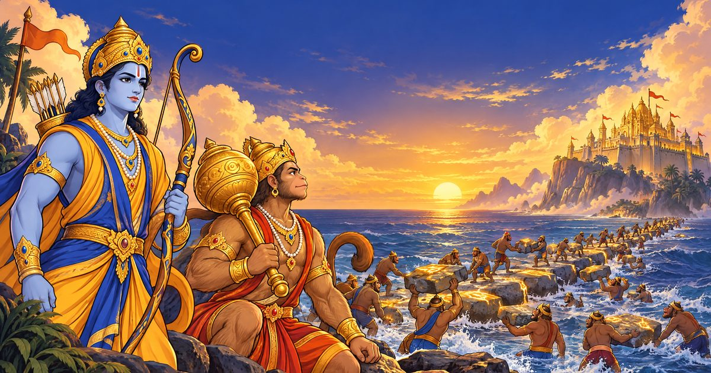

# Xây Cầu Ram Setu

### ▶ [Chơi ngay: tranthanhhai1997.github.io/ram-setu](https://tranthanhhai1997.github.io/ram-setu/)

[](https://tranthanhhai1997.github.io/ram-setu/)

Game trình duyệt ném đá xây cầu theo sử thi Ramayana — chạy trên máy tính và điện thoại, cài được như ứng dụng (PWA), chơi offline, hỗ trợ Tiếng Việt / English / हिन्दी.

- **12 màn cốt truyện** qua 3 chương, hội thoại cùng Rama, Hanuman, Nala, Ravana…
- **Quỷ Rakshasa canh cầu**, thủy quái Makara, cầu lửa, gió giật, chim mòng biển
- **Biển vô tận**, **Thử thách ngày**, 13 thẻ nhân vật, 16 thành tựu, cửa hàng trang phục
- **Điều khiển:** kéo về sau như ná cao su rồi thả · bàn phím: giữ `Space` nạp lực, `1`–`4` vật phẩm, `P` tạm dừng

## Chạy trên máy

Không cần build — chạy bằng server tĩnh bất kỳ:

```bash
python3 -m http.server 8765
```

Mở `http://localhost:8765/`. File gốc được giữ nguyên: `Game Xây Cầu Ram Setu.html`.

## Cấu trúc

| File | Nội dung |
|---|---|
| `index.html` | Bố cục trang, các lớp phủ (menu, hội thoại, thắng/thua, cửa hàng…) |
| `css/style.css` | Giao diện |
| `js/data.js` | **Toàn bộ nội dung & cân bằng**: phim, nhân vật, 12 màn, cốt truyện, vật phẩm, trang phục, thành tựu |
| `js/save.js` | Lưu tiến trình (localStorage, khóa `ramsetu_save_v1`) |
| `js/i18n.js` | Đa ngôn ngữ vi / en / hi: chuỗi giao diện (`STR`) + bản dịch nội dung (`CONTENT`) |
| `manifest.webmanifest`, `sw.js`, `icons/` | PWA: cài lên màn hình chính, chơi offline |
| `js/audio.js` | Hiệu ứng âm thanh + nhạc nền tổng hợp bằng WebAudio |
| `js/game.js` | Engine: vật lý, chướng ngại, vẽ canvas, điều khiển |
| `js/ui.js` | Luồng màn hình, menu, cửa hàng, quà ngày, chia sẻ |

## Cần làm trước khi phát hành

- `FILM.releaseDate` trong `js/data.js` đang là **giá trị giả định** — cập nhật theo ngày công chiếu chính thức tại thị trường mục tiêu.
- `FILM.shareUrl`: đã đặt là `https://tranthanhhai1997.github.io/ram-setu/` (đổi nếu chuyển tên miền).
- Quảng cáo đang là **mô phỏng**: banner (`.banner-slot`), interstitial (sau mỗi 2 màn thắng, `winNext` trong `ui.js`), rewarded (`openAd("rewarded", …)`). Thay bằng SDK thật tại các vị trí này.
- Không dùng logo, hình ảnh, tên diễn viên hay nhạc phim khi chưa có thỏa thuận bản quyền với hãng phim.

## Đa ngôn ngữ

- Ngôn ngữ tự nhận theo trình duyệt (vi / hi, còn lại → en); người chơi đổi ở thanh trên hoặc Cài đặt.
- Thêm/sửa chuỗi: `STR.<lang>` trong `js/i18n.js`. Thiếu khóa sẽ tự lấy tiếng Việt.
- Thêm ngôn ngữ mới (vd. `ta` Tamil): thêm vào `LANGS`, `STR.ta`, `CONTENT.ta`.
- Bản tiếng Anh/Hindi do AI dịch — **cần người bản ngữ duyệt** trước khi phát hành.

## PWA

- Cần phục vụ qua **HTTPS** (hoặc localhost) để cài đặt và chạy offline.
- Mỗi lần phát hành: tăng `VERSION` trong `sw.js`, nếu không người chơi có thể nhận bản cũ từ bộ nhớ đệm.
- Khi phát triển: DevTools → Application → Service Workers → bật "Update on reload".

## Ảnh minh họa

Khai báo trong `ART` (cuối `js/data.js`) — không cần sửa code:
- `ART.portraits.<id>`: chân dung cho hội thoại & thẻ (512×512 WebP).
- `ART.monkey.<skinId>`: sprite nhân vật ném đá (`src, w, h, ax, ay`).
- Ảnh minh họa: `img/portraits/` (14 chân dung), `img/sprites/` (5 trang phục × 3 tư thế), `img/bg/` (7 bầu trời, 3 bờ biển), `img/ui/` (ảnh chủ đạo, huy hiệu, khung, 10 biểu tượng, Makara/cầu lửa/chim). Tất cả khai báo trong `ART` (`js/data.js`). Ảnh PNG gốc không đưa vào repo (`.gitignore`); muốn xuất cỡ lớn hơn phải tạo lại ảnh.
